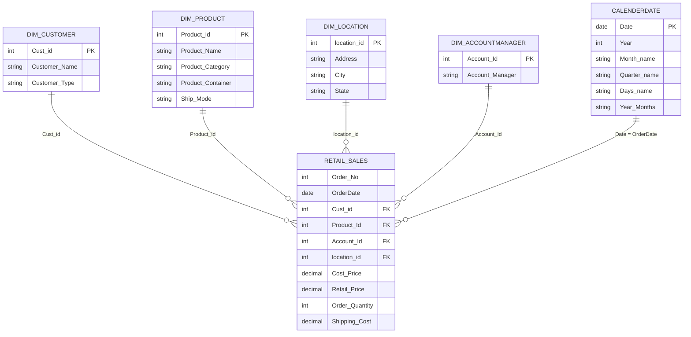

# 🛒 Retail Sales Analysis Dashboard — Power BI

An end-to-end Power BI project that turns raw retail order data into an interactive, 4-page sales dashboard: from data cleaning in Power Query, to a star-schema data model, to 35+ DAX measures, to a navigable report covering **time trends, customer behavior, and product performance**.

> **Tools:** Power BI Desktop · Power Query (M) · DAX · Star Schema Modeling · Data Visualization

---

## 📌 Table of Contents
1. [Project Overview](#-project-overview)
3. [Key Results](#-key-results)
4. [Dashboard Pages](#-dashboard-pages)
5. [Data Model](#-data-model)
6. [Data Preparation (Power Query)](#-data-preparation-power-query)
7. [DAX Measures](#-dax-measures)
8. [Key Insights](#-key-insights)
9. [Interactivity & UX](#-interactivity--ux)
10. [How to Use This Repo](#-how-to-use-this-repo)

---

## 🎯 Project Overview

**Business questions this dashboard answers**

- How are sales, profit, cost, and quantity trending over time (year / quarter / month / day)?
- Which customers and customer segments drive the most revenue and profit?
- Which products, categories, ship modes, and locations perform best?
- How profitable is the business, and how concentrated is it?

**Dataset:** retail order transactions (CSV, 24 columns) — **5,000 order lines**, **1,366 orders**, **789 customers**, **257 products**, covering **Feb 2013 – Feb 2017**, shipped to **Sydney (NSW)** and **Melbourne (VIC)**.

---


---

## 🏆 Key Results

| KPI | Value |
|---|---|
| **Total Sales** | **$5.19M** |
| **Total Cost** | **$2.77M** |
| **Total Profit** | **$2.42M** |
| **Profit Margin** | **46.6%** |
| **Units Sold** | **132,389** |
| **Orders** | **1,366** |
| **Customers** | **789** |
| **Products** | **257** |
| **Average Order Value (AOV)** | **$3,796.72** |

---

## 📊 Dashboard Pages

### 1️⃣ Page Navigation (Landing page)
A branded landing page with button-style icons and a page navigator that links to the three analysis pages.

### 2️⃣ Time Series Analysis
- **4 KPI cards** — Total Sales, Total Profit, Total Cost, Total Quantity — each paired with a mini **area-chart sparkline** by month.
- **Total Sales by Month** (column chart) and **Total Profit by Quarter** (column chart).
- **Orders by Month** (line chart).
- **Two matrices** by Year / Quarter showing **Total Sales + YTD Sales** and **Total Profit + YTD Profit**.
- **5 slicers:** Year, Quarter, Month, Day, and Year-Month.
- A dynamic text summary showing total orders, products, and customers for the selected period.

### 3️⃣ Customers Behavior Analysis
- **Total Sales & Profit by Customer Type** (clustered column).
- **Cost share by Customer Type** (donut).
- **Customer matrix** with Sales, Profit, Cost, and each customer's **% contribution** to total sales / profit / cost.
- **"Top customer" cards** that update with filters: highest customer by **Sales**, **Profit**, **Cost**, and **Number of Orders**.
- Slicers for Customer Type and Customer Name.

### 4️⃣ Product Performance
- **KPI strip:** #Customers, #Orders, #Products, AOV, Sales / Cost / Profit per Product.
- **Top 10 Products by Total Sales** (bar chart).
- **Sales vs. Profit by Product Category** (combo chart: columns + line).
- **Profit by City** and **Profit by State** (donut charts).
- Cards for **top Ship Mode** and **top Product Category** by sales.
- Slicers for Ship Mode and Product Container.

---

## 🧩 Data Model

The model follows a **star schema**: one fact table connected to four dimension tables through surrogate keys, plus a dedicated date table for time intelligence.



| Table | Type | Rows | Description |
|---|---|---:|---|
| `Retail Sales` | Fact | 5,000 | One row per order line; prices, quantities, costs, and foreign keys |
| `Dim_Customer` | Dimension | 789 | Customer name and type (Corporate, Home Office, Small Business, Consumer) |
| `Dim_Product` | Dimension | 257 | Product name, category, container, ship mode |
| `Dim_Location` | Dimension | 196 | Address, city, state |
| `Dim_Accountmanager` | Dimension | 19 | Account managers |
| `CalenderDate` | Date table | 1,826 | Built with `CALENDARAUTO()`; Year, Month, Quarter, Day, and Year-Month columns |
| `Calculation` | Measure table | — | Holds all DAX measures in one place |
| `Summary Stats` | Calculation group | — | `Avg_Sales`, `Max_Sales`, `Min_Sales` items using `SELECTEDMEASURE()` |

All relationships are **many-to-one, single-direction**.

---

## 🧹 Data Preparation (Power Query)

Starting from a single flat CSV file, the following transformations were applied:

- **Promoted headers** and set proper data types (currency, percentage, integer, date).
- **Cleaned `Order No`** by extracting the numeric part after the delimiter and converting it to an integer.
- **Rebuilt date columns:** split the text-based `Order Date` / `Ship Date` on the delimiter, reordered the parts, and merged them back into valid dates.
- **Handled missing values:** blank addresses replaced with `"Not Address Determined"`.
- **Normalized the flat file into a star schema:** created `Dim_Customer`, `Dim_Product`, `Dim_Location`, and `Dim_Accountmanager` by keeping the relevant columns and removing duplicates.
- **Generated surrogate keys** (`Cust_id`, `Product_Id`, `Account_Id`, `location_id`) with index columns.
- **Merged the keys back** into the fact table with left-outer joins, then removed the descriptive columns so the fact table keeps only keys and numeric values.

**Calculated column:** `Gross_Profit = DIVIDE('Retail Sales'[Profit Margin], 'Retail Sales'[Retail Price])`

**Date table columns:** `Year`, `Month_num`, `Quarter_num`, `Month_name` (`MMM`), `Quarter_name` (`Q-1`…`Q-4`), `Days_name` (`DDD`), `Year_Months`.

---

## 🧮 DAX Measures

All measures live in a dedicated `Calculation` table and are grouped below by purpose.

### Core KPIs
```DAX
Total_Sales = SUMX('Retail Sales', 'Retail Sales'[Order Quantity] * 'Retail Sales'[Retail Price])

Total Cost  = SUMX('Retail Sales', 'Retail Sales'[Order Quantity] * 'Retail Sales'[Cost Price])

Total_Profit = [Total_Sales] - [Total Cost]

%Profit Margin = DIVIDE([Total_Profit], [Total_Sales])

Total Quantity = SUM('Retail Sales'[Order Quantity])

Total_order_Cost = [Total Cost] + SUM('Retail Sales'[Shipping Cost])

#Orders    = DISTINCTCOUNT('Retail Sales'[Order No])
#Customers = DISTINCTCOUNT('Retail Sales'[Cust_id])
#Products  = DISTINCTCOUNT('Retail Sales'[Product_Id])

AOV = DIVIDE([Total_Sales], [#Orders])
```

### Time Intelligence
```DAX
YTD Sales  = TOTALYTD([Total_Sales], CalenderDate[Date])
YTD Profit = TOTALYTD([Total_Profit], CalenderDate[Date])

LY_Sales = CALCULATE([Total_Sales], SAMEPERIODLASTYEAR(CalenderDate[Date]))

YoY =
VAR LY_Sales    = CALCULATE([Total_Sales], SAMEPERIODLASTYEAR(CalenderDate[Date]))
VAR Total_Sales = [Total_Sales]
RETURN DIVIDE(Total_Sales - LY_Sales, LY_Sales)

Rolling12Month =
CALCULATE([Total_Sales], DATESINPERIOD(CalenderDate[Date], LASTDATE(CalenderDate[Date]), -12, MONTH))

CondionalCol = IF([Total_Sales] > [LY_Sales], 0, 1)   -- flag: 0 = above last year, 1 = below
SelectedYear = SELECTEDVALUE(CalenderDate[Year])
```

### Averages & Per-Unit Metrics
```DAX
Sales_Per_Products  = DIVIDE([Total_Sales],  [#Products])
Cost_per_Products   = DIVIDE([Total Cost],   [#Products])
profit_per_Products = DIVIDE([Total_Profit], [#Products])

Sales_Per_Customers  = DIVIDE([Total_Sales],  [#Customers])
Profit_Per_Customers = DIVIDE([Total_Profit], [#Customers])

sales_per_Months  = DIVIDE([Total_Sales],  DISTINCTCOUNT(CalenderDate[Month_name]))
Cost_Per_months   = DIVIDE([Total Cost],   DISTINCTCOUNT(CalenderDate[Month_name]))
Profit_per_Months = DIVIDE([Total_Profit], DISTINCTCOUNT(CalenderDate[Month_name]))
```

### Customer Ranking & Contribution
```DAX
TopCustomersbysales = RANKX(ALL(Dim_Customer[Customer Name]), [Total_Sales], , DESC, Dense)

highestCustomer-Sales   = TOPN(1, VALUES(Dim_Customer[Customer Name]), [Total_Sales],  DESC)
HighestCustomerByProfit = TOPN(1, VALUES(Dim_Customer[Customer Name]), [Total_Profit], DESC)
TopCustomerByCost       = TOPN(1, VALUES(Dim_Customer[Customer Name]), [Total Cost],   DESC)
highestCsutomer_Orders  = TOPN(1, VALUES(Dim_Customer[Customer Name]), [#Orders],      DESC)

%Customer_sales =
VAR total_sales = [Total_Sales]
VAR ALL_Sales   = CALCULATE([Total_Sales], ALL(Dim_Customer[Customer Name]))
RETURN DIVIDE(total_sales, ALL_Sales)
-- %Customer_profit and %Customer_Cost follow the same pattern
```

### Product Highlights
```DAX
highestShipmodeSales       = TOPN(1, VALUES(Dim_Product[Ship Mode]),        [Total_Sales], DESC)
highestpro_categorybySales = TOPN(1, VALUES(Dim_Product[Product Category]), [Total_Sales], DESC)
```

### Calculation Group — `Summary Stats`
```DAX
Avg_Sales = AVERAGEX('Retail Sales', SELECTEDMEASURE())
Max_Sales = MAXX('Retail Sales', SELECTEDMEASURE())
Min_Sales = MINX('Retail Sales', SELECTEDMEASURE())
```
A single calculation group that applies **average / max / min** to *any* measure, avoiding the need to write duplicate measures.

---

## 💡 Key Insights

> Figures below are calculated from the full dataset with no filters applied.

**Overall performance**
- The business generated **$5.19M in sales** and **$2.42M in profit**, a healthy **46.6% profit margin**.
- Yearly sales: **2013: $1.29M → 2014: $1.17M (−9.4%) → 2015: $1.25M (+7.2%) → 2016: $1.37M (+9.7%)**. 2016 was the strongest full year, with the highest margin among full years (47.9%).
- *Note:* 2017 only contains data up to early February, so it is excluded from year-over-year comparisons.

**Seasonality**
- **Q4 is the strongest quarter** (~$1.49M sales, ~$713K profit); **Q2 is the weakest** (~$1.16M sales).
- **October** is the peak month (~$595K sales) and **April** is the lowest (~$292K).

**Customers**
- **Corporate** customers lead with **~$1.91M (36.9%)** of sales, followed by Home Office (27.1%), Small Business (22.1%), and Consumer (13.8%).
- Revenue is **not concentrated in a few accounts** — the single largest customer accounts for only **~1.8%** of total sales, which means low dependency risk.

**Products**
- **Office Supplies** account for **~69%** of sales (~$3.59M), followed by Technology (~$1.48M).
- **Furniture** has the **highest margin (57.6%)** but contributes just ~2% of sales — a potential growth opportunity.
- Two copier models (**Cando PC940** and **HFX LaserJet 3310**) alone generate roughly **$1.9M**, over a third of total sales.

**Logistics & Geography**
- **Regular Air** handles ~92% of sales by value.
- **NSW (Sydney)** generates about **71%** of profit versus ~29% for **VIC (Melbourne)**.

---

## 🖱 Interactivity & UX

- **Page navigation** via a navigator and clickable icon buttons.
- **Bookmarks** (6 total) that show/hide the filter panels on each page for a cleaner canvas.
- **Cross-filtering** between all visuals on a page.
- **Time-intelligence slicers** (Year, Quarter, Month, Day, Year-Month).
- **Dynamic "Top customer / Top category / Top ship mode" cards** that respond to any filter selection.
- Custom icon set and consistent colour theme (Fluent 2 base theme).

---

## 🚀 How to Use This Repo

```
📦 retail-sales-powerbi
 ┣ 📂 data/          # source CSV
 ┣ 📂 images/        # dashboard screenshots
 ┣ 📄 Retail_Sales_Full_Project.pbix
 ┗ 📄 README.md
```

1. Clone or download this repository.
2. Open `Retail_Sales_Full_Project.pbix` in **Power BI Desktop**.
3. If prompted, update the CSV source path: **Transform data → Data source settings → Change Source…**
4. Click **Refresh** and explore the dashboard.

---

## 👤 Author
**Mohammed Weal Mohammed**

*Feedback and suggestions are welcome!*
